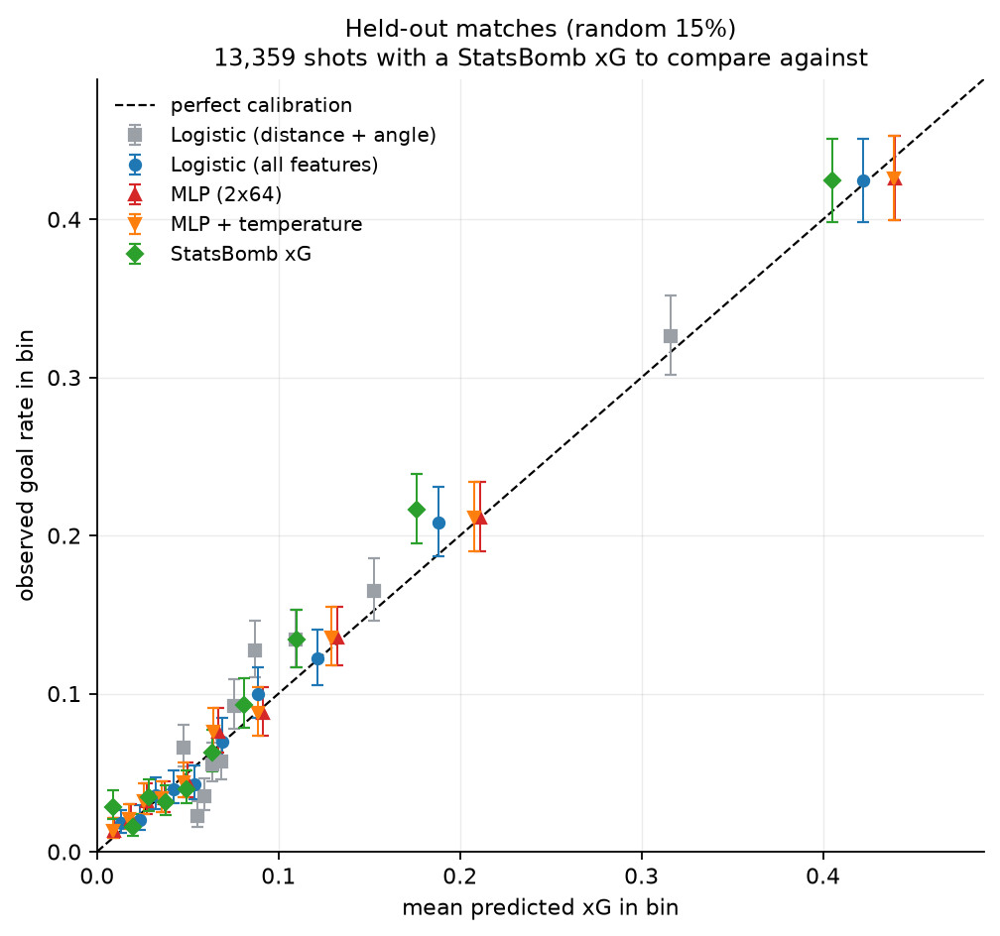
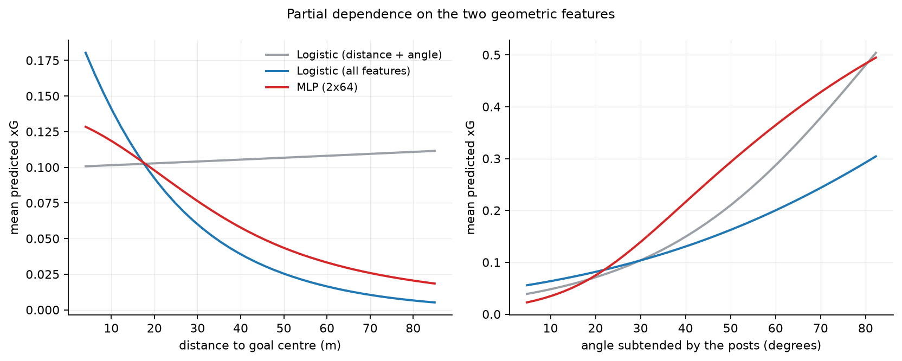
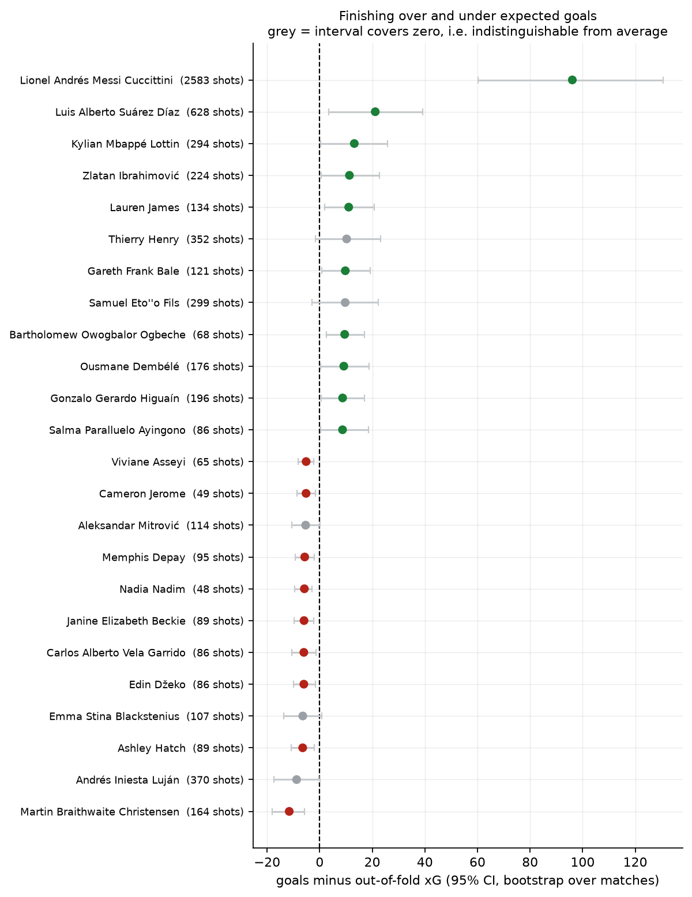

# xg-jax

Shot-level expected goals in JAX, trained on 99,746 non-penalty shots from StatsBomb's
open data and validated the way a club analyst would want: split by match so no shot
shares a game with its training data, held out against an entire competition the model
never saw, and scored on calibration first. A small MLP beats StatsBomb's own xG on the
random test split (log loss 0.2748 vs 0.2775) and matches it on the held-out Premier
League 2015/16 season. The models are then used for the analysis people actually ask
for — who finished above and below their chances — with the honest answer attached: of
925 players with 30+ shots, 99 have an interval clear of zero, and it takes around
**736 shots** before a genuinely two-percentage-point-better finisher separates from noise.

<a href="https://statsbomb.com/what-we-do/hub/free-data/">
  
</a>

Data provided by StatsBomb. See [Data and attribution](#data-and-attribution).

## Quickstart

```bash
git clone https://github.com/daltonoscar0/xg-jax && cd xg-jax
python3.11 -m venv .venv && source .venv/bin/activate

pip install -r requirements.lock && pip install -e . --no-deps   # the pinned set
# or: pip install -e ".[dev]"                                     # latest in range

xg fetch                      # ~1.7 GB, stays compressed; records the commit used
xg train --model baseline     # logistic on distance + angle
xg train --model logistic     # logistic on all features
xg train --model mlp          # 2x64 MLP, early stopping, + temperature scaling
xg evaluate                   # metrics, calibration, plots -> results/
xg analyse                    # cross-fit by match, finishing table -> results/

xg shot --x 108 --y 40 --body-part right_foot
# {"xg": 0.2202, "distance_m": 11.0, "angle_deg": 36.81, ...}
```

Every number in this README comes from a run of exactly those commands, saved under
[`results/`](results/). CPU only; the whole pipeline takes about half an hour on a laptop,
most of it downloading and reading the data.

[`requirements.lock`](requirements.lock) is the exact set those runs used — 46 packages
with versions, `sportio` pinned to a commit rather than a branch. `pyproject.toml` keeps
the loose ranges a library should declare, so both installs above work; the lock is what
makes 0.2748 a number you can get back rather than a number I once got. CI installs from
it, regenerate it with `scripts/lock.sh`.

## Results

Held-out matches (15% of all matches, never trained on), 13,359 shots.
95% intervals from 1,000 bootstrap resamples **of matches**, not of shots.

| Model | Log loss | Brier | AUC | Calib. error | Slope | Intercept |
|---|---|---|---|---|---|---|
| Logistic (distance + angle) | 0.3103 [0.2977, 0.3221] | 0.0880 [0.0836, 0.0920] | 0.716 [0.700, 0.731] | 0.0198 [0.0159, 0.0255] | 1.029 | 0.112 |
| Logistic (all features) | 0.2800 [0.2682, 0.2909] | 0.0808 [0.0768, 0.0845] | 0.797 [0.785, 0.809] | 0.0061 [0.0051, 0.0130] | 0.975 | −0.012 |
| **MLP (2×64)** | **0.2748** [0.2632, 0.2857] | **0.0792** [0.0754, 0.0829] | **0.806** [0.793, 0.818] | **0.0050** [0.0046, 0.0108] | 0.962 | −0.071 |
| MLP + temperature scaling | 0.2749 [0.2631, 0.2859] | 0.0792 [0.0754, 0.0829] | 0.806 [0.793, 0.818] | 0.0054 [0.0046, 0.0112] | 0.947 | −0.071 |
| *StatsBomb xG (reference)* | *0.2775* [0.2641, 0.2897] | *0.0792* [0.0752, 0.0829] | *0.802* [0.789, 0.816] | *0.0142* [0.0107, 0.0201] | *0.991* | *0.114* |

Held-out **competition**: the entire Premier League 2015/16 season, 9,817 shots, never
touched during development.

| Model | Log loss | Brier | AUC | Calib. error | Slope | Intercept |
|---|---|---|---|---|---|---|
| Logistic (distance + angle) | 0.2848 [0.2720, 0.2991] | 0.0791 [0.0745, 0.0840] | 0.718 [0.700, 0.735] | 0.0212 [0.0167, 0.0268] | 0.956 | −0.193 |
| Logistic (all features) | 0.2564 [0.2441, 0.2703] | 0.0720 [0.0680, 0.0766] | 0.788 [0.771, 0.804] | 0.0080 [0.0061, 0.0147] | 0.977 | −0.117 |
| MLP (2×64) | 0.2531 [0.2411, 0.2669] | 0.0713 [0.0672, 0.0757] | 0.797 [0.781, 0.811] | 0.0095 [0.0072, 0.0162] | 0.960 | −0.170 |
| MLP + temperature scaling | 0.2530 [0.2408, 0.2670] | 0.0713 [0.0672, 0.0757] | 0.797 [0.781, 0.811] | 0.0087 [0.0065, 0.0154] | 0.945 | −0.170 |
| *StatsBomb xG (reference)* | *0.2529* [0.2400, 0.2675] | *0.0705* [0.0663, 0.0752] | *0.795* [0.780, 0.810] | *0.0077* [0.0063, 0.0142] | *0.984* | *−0.010* |



**Reading this honestly.** The MLP's 0.0027 log-loss edge over StatsBomb on the test
split is about a fifth of the bootstrap interval's width, so it is a tie that happens to
have fallen our way, not a win. On the held-out competition StatsBomb are ahead by
0.0002, which is the same tie falling theirs. The one difference that does look real is
calibration on the test split: our calibration error of 0.0050 against their 0.0142, with
intervals that barely overlap — and the reason is visible in the intercept column.
StatsBomb's xG is fitted on their full data; on this subset it sits slightly high, which
is exactly what a positive intercept means. Ours was fitted on this subset. That is an
advantage of circumstance, not of method.

**On the held-out competition every model's intercept goes negative** (−0.117 for the
logistic, −0.170 for the MLP, and −0.010 even for StatsBomb). All of them predict a touch
too high on Premier League 2015/16 relative to the training mix, which is heavy on
women's competitions and older La Liga. This is the number to watch when taking a model
built on open data into one specific league, and it is the argument for refitting an
intercept on the target competition before trusting totals.

**Temperature scaling barely moves.** The fitted temperature is 0.984, so the MLP was
close to calibrated already. It improves the held-out competition's calibration error
(0.0095 → 0.0087) and slightly worsens the test split's (0.0050 → 0.0054), while pushing
the slope further from 1. Both versions are reported because neither clearly wins.

### What the models learned



Top effects from the full logistic model, in standardised units
([`results/coefficients.csv`](results/coefficients.csv)):

| Feature | Coefficient | Odds ratio | Note |
|---|---|---|---|
| `technique_backheel` | −1.594 | 0.20 | on 0.4% of shots |
| `shot_type_corner` | +1.550 | 4.71 | **0.035% of shots — noise** |
| `gk_dist_goal_line` | +1.236 | 3.44 | per SD |
| `has_freeze_frame` | −1.131 | 0.32 | **constant: not identifiable** |
| `shot_open_goal` | +0.946 | 2.58 | |
| `body_part_head` | −0.910 | 0.40 | |
| `distance` | −0.711 | 0.49 | per SD |
| `assist_type_through_ball` | +0.587 | 1.80 | |
| `angle` | +0.473 | 1.60 | per SD |

Two of the largest numbers in that table mean nothing, and the table says so rather than
leaving a reader to find out. `has_freeze_frame` is constant once penalties are excluded
(see below), so it is collinear with the intercept and the fit can put any value on it.
`shot_type_corner` is set on 33 shots out of 99,746. The coefficient table flags every
column that is constant or set on under 0.1% of training shots, because the headline
effect of an unflagged table would be two artifacts.

Of the features that do mean something: a keeper further off his line is the strongest
single signal after geometry, which mostly identifies one-on-ones and counters rather
than measuring the keeper's positioning as such. A header has roughly 60% lower odds
than the same chance on the foot, and a through ball raises them by 80%.

The partial dependence plot repays a careful read, because two of its three curves are
not saying what a glance suggests:

- **The baseline's distance curve is almost flat**, and very slightly *rising*. That is
  not a broken model — the baseline scores a perfectly sensible 0.716 AUC. It is what
  partial dependence does with correlated inputs. Sweeping distance across the grid while
  holding each row's real angle fixed produces shots that do not exist (35 m out, subtending
  the angle of a six-yard-box tap-in), and with only two features to work with the fit
  loads the geometry onto the angle. Partial dependence is a statement about the model,
  not about football, and this is the panel that shows the difference.
- **The MLP's distance curve is flatter than the full logistic's**, and its angle curve
  steeper. Both models are near-identical in every headline metric, so this is not one of
  them being more right; it is two different decompositions of the same correlated
  geometry. Reading either curve as "how much distance matters" would be a mistake.

The full logistic model's curves are the ones to read for a sense of magnitude, and they
behave: 0.18 at four metres, 0.09 at twenty, 0.026 at fifty, and 0.01 at seventy.

## Data and attribution

Data from [StatsBomb's open data](https://github.com/statsbomb/open-data), pinned to
commit [`4b73468`](https://github.com/statsbomb/open-data/tree/4b73468fc5b0f1950f9f66fada70ad3a4f9327cb)
and recorded in `data/raw/open_data_commit.txt` by `xg fetch`.

> If you publish, share or distribute any research, analysis or insights based on this
> data, please state the data source as StatsBomb and use our logo, available in our
> [Media Pack](https://statsbomb.com/media-pack/).

The StatsBomb Public Data User Agreement also governs what this repository can do with
the data, and two clauses shape the design here:

- **1.2.1** — the user may not *"edit, distort, distribute, reproduce, sell or in any way
  provide the data to any external or third party"*. So no StatsBomb data is committed:
  not the event JSON, not the derived shot table, not a cached parquet. `data/raw/` and
  `data/cache/` are gitignored, CI runs against a synthetic fixture generated by
  [`tests/make_fixtures.py`](tests/make_fixtures.py), and anyone reproducing this
  downloads their own copy with `xg fetch`.
- **1.2.2** — the data and any analysis derived from it may not be commercially
  exploited. This repository is a portfolio and research project, published under MIT for
  the *code*; the data it reads is StatsBomb's and stays under their agreement.

### Coverage

80 competition-seasons, 3,961 matches, 100,864 shots, 11,086 goals
([`results/data_summary.csv`](results/data_summary.csv)). The four big 2015/16 men's
leagues contribute 38% of the shots; the rest is a wide mix of women's leagues,
international tournaments, and a long tail of individual La Liga matches going back to
1973. This is a *biased* sample of football, not a random one.

**Penalties are excluded** and reported separately
([`results/penalties.csv`](results/penalties.csv)): 1,118 penalties, 853 scored, a 76.3%
conversion rate against a StatsBomb mean xG of 0.784. A penalty is a near-constant that
every model predicts perfectly, so leaving them in flatters every metric by adding a
large, trivially predictable bucket. 99,746 non-penalty shots remain.

**Freeze-frame coverage is 100% of modelled shots.** Of the 994 shots with no freeze
frame in the whole dataset, every single one is a penalty. The imputation path and the
`has_freeze_frame` indicator are therefore built, tested and never exercised on real
modelled data, and the "shots without a freeze frame" breakdown is empty by construction
rather than by omission. The code keeps both because the next competition StatsBomb
release may not be so complete.

## Method

### Features

Everything is knowable at the instant the ball is struck. The feature builder
([`src/xg/features.py`](src/xg/features.py)) enforces that rather than trusting
discipline: `assert_no_leakage` refuses any column naming an outcome, an end location, a
later event, or StatsBomb's own xG, and it runs on the shipped column list in the test
suite as well as on every matrix built at runtime.

- **Geometry** — distance to the goal centre, the angle subtended by the posts, raw x/y,
  and absolute lateral offset. Computed in metres on a canonical 105×68 pitch using
  [sportio](https://github.com/daltonoscar0/sportio)'s landmark mapping, not a linear
  rescale of StatsBomb's nominal 120×80 grid: a linear rescale shrinks the goal to 6.80 m
  and the penalty spot to 10.50 m, and distance is the feature the whole model turns on.
- **Freeze frame** — opponents inside the ball/post triangle, the keeper's distance from
  his goal line and from the shot line, and distance to the nearest outfield defender.
- **Context** — body part, shot type, play pattern, technique; first-time, one-on-one,
  open-goal, aerial-won, follows-dribble, redirect and under-pressure flags.
- **Assist** — from the key pass where there is one: through ball, cross, cutback or
  other, plus pass length.

Continuous features are standardised and missing values imputed with medians fitted on
the **training split only**, then applied unchanged everywhere else.

### Splits

Shots from the same match are not independent — same two teams, same pitch, same game
state, and in the open data the same analyst. Splitting by shot would put a striker's
first-half effort in train and his second-half effort in test. So:

- **70 / 15 / 15 by match**, stratified by competition-season, seed 20260101.
  63,126 train / 13,444 validation / 13,359 test shots.
- **Premier League 2015/16 held out entirely** (9,817 shots), never looked at during
  development.
- Match IDs for all four splits are in [`results/splits.json`](results/splits.json), and
  a test asserts no match ID appears in two of them.

### Models

All three are [Equinox](https://github.com/patrick-kidger/equinox) modules trained with
[Optax](https://github.com/google-deepmind/optax) AdamW under `eqx.filter_jit`, with
early stopping on validation log loss that restores the best epoch rather than the last.

1. **Baseline** — logistic regression on distance and angle only. Initialised at zero:
   the problem is convex, so the start does not matter and a zero start makes the fit
   exactly reproducible.
2. **Full logistic** — the same, on all 46 design columns.
3. **MLP** — two hidden layers of 64, ReLU, weight decay on weights but not biases.
   Stopped at epoch 8 of 28; the training curves are in
   [`results/training_curves.png`](results/training_curves.png).
4. **Temperature scaling** — one parameter fitted on validation logits with the model
   frozen.

No class weighting and no resampling anywhere. Goals are 11% of shots, which is not rare
enough to need either, and both destroy calibration — the whole point of an xG model is
that 0.1 means one in ten.

### Metrics

Log loss, Brier, AUC, reliability tables, expected calibration error and the calibration
slope/intercept are all written out in [`src/xg/metrics.py`](src/xg/metrics.py) rather
than imported, and tested against values computed by hand. Two choices worth naming:

- **Equal-count bins, not equal-width.** Equal-width bins put 95% of shots in the first
  bucket and then report a calibration error dominated by three shots in the last. Bins
  are also never allowed to split a run of identical predictions.
- **The bootstrap resamples matches.** Resampling shots treats 25 shots in a match as 25
  independent draws and returns intervals roughly a third too narrow.

## Who finished above and below their xG

Every shot is scored by a model that never saw its match: five folds by match, each
refitting the standardisation constants as well as the weights
([`src/xg/analysis.py`](src/xg/analysis.py)). Across all 99,746 shots the cross-fit xG
totals 10,330 against 10,233 actual goals, a ratio of 0.991 — a calibration check that
costs nothing and would have caught a broken fold.



| Player | Shots | Goals | xG | G−xG | 95% CI |
|---|---|---|---|---|---|
| Lionel Messi | 2,583 | 442 | 345.9 | **+96.1** | [+60.2, +130.6] |
| Luis Suárez | 628 | 132 | 110.9 | +21.1 | [+3.4, +39.2] |
| Kylian Mbappé | 294 | 55 | 41.8 | +13.2 | [+0.4, +25.8] |
| Zlatan Ibrahimović | 224 | 44 | 32.7 | +11.3 | [+0.6, +22.6] |
| Lauren James | 134 | 26 | 15.0 | +11.0 | [+1.9, +20.7] |
| … | | | | | |
| Andrés Iniesta | 370 | 24 | 32.8 | −8.8 | [−17.3, +0.2] |
| Martin Braithwaite | 164 | 14 | 25.6 | −11.6 | [−18.0, −5.7] |

Full table: [`results/finishing.csv`](results/finishing.csv).

### Why most of this is noise

Goals are Bernoulli draws. A player taking shots of average quality (0.104 xG each)
accumulates a goals-minus-xG that is pure luck, with standard deviation √(Σp(1−p)):

| Shots | SD of G−xG by luck alone | 95% band |
|---|---|---|
| 30 | 1.52 | ±2.97 goals |
| 60 | 2.15 | ±4.20 goals |
| 100 | 2.77 | ±5.43 goals |
| 300 | 4.80 | ±9.40 goals |

So a striker with a season's 60 shots and +4 goals over expectation has produced a
number that an exactly average finisher produces one time in twenty. The 30-shot
threshold used here is the spec's and it is generous: at 30 shots the luck band is ±3
goals, which is wider than almost any real finishing effect.

**What it would take.** Invert the same arithmetic. A player who is genuinely 2
percentage points better per shot — which would make them one of the best finishers
alive — accumulates 0.02n goals of signal against 1.96√(0.0766n) of noise. Those cross at
**736 shots**. In this entire dataset exactly one player clears that bar, and it is
Messi. Everyone else in the table above is a hypothesis, not a finding: 99 of 925
qualifying players have an interval clear of zero, against the ~46 you would expect from
pure chance at a 5% level, so there is *some* real signal in aggregate — but you cannot
tell which 53 of those 99 it belongs to.

The practical version for a recruitment meeting: finishing over-performance is not a
reliable scouting signal at the sample sizes a single player provides. Use xG to judge
chance quality and volume, which stabilise in tens of shots, not the residual, which does
not stabilise in hundreds.

### Chelsea, 2015/16

The held-out competition is a full Premier League season, so the club tables cover all 38
of Chelsea's matches ([`results/chelsea_team.csv`](results/chelsea_team.csv)). Every xG
here is out of fold.

| Season | Matches | Goals for | xG for | Goals against | xG against | xG difference |
|---|---|---|---|---|---|---|
| Premier League 2015/16 | 38 | 51 | 53.93 | 48 | 49.76 | **+4.17** |
| Premier League 2003/04 | 2 | 2 | 1.96 | 4 | 2.88 | −0.92 |
| Champions League 2011/12 | 1 | 1 | 0.29 | 1 | 2.17 | −1.88 |

The 2015/16 row is the interesting one: the defending champions finished tenth, and the
model says their underlying numbers were an xG difference of +4.2 across 38 matches —
better than mid-table results suggest, but nowhere near a title-winning team's. They
came in slightly under their xG at both ends (51 goals from 53.9 xG for, 48 conceded
from 49.8 against), which is small enough to be noise over one season. The collapse was
mostly a genuinely mediocre team, not bad luck in front of goal.

Two caveats on those counts. They cover **non-penalty shots only**: including penalties
the same 38 matches hold 55 Chelsea goals and 51 conceded. And own goals are not shot
events at all, so neither figure matches an official season table. Finally, the other
two rows cover 2 and 1 matches respectively — individual matches that happen to be in
the open data, not seasons, and they should not be read as anything.

## Limitations

- **The open data is a biased sample.** 80 competition-seasons chosen by StatsBomb for
  release, heavy on 2015/16 men's leagues and recent women's leagues, with a long tail of
  single historic matches. A model trained on this mix carries that mix's base rates,
  which is exactly what the negative calibration intercepts on the Premier League holdout
  show.
- **No tracking data.** Freeze frames give defender positions at the moment of the shot
  but nothing about movement, and nothing at all about what the keeper does afterwards.
- **No post-shot information**, by design. This is xG, not post-shot xG; it cannot and
  should not know where the ball ended up.
- **Penalties excluded.** Their conversion rate is reported but not modelled.
- **Finishing residuals are mostly noise**, as above, and the Chelsea tables are one
  season.
- **The MLP's edge is inside the error bars.** On this data a well-specified logistic
  model gets within about 0.005 log loss of a neural one, which is consistent with the
  published view that event-data xG has a low ceiling. The MLP is here because the spec
  asked for it and because it is honestly reported, not because it is the better choice.

## Repository

```
src/xg/
  geometry.py   pitch landmarks, distance, angle, shot triangle
  data.py       StatsBomb -> one shot table, streamed from the archive
  features.py   feature builder, leakage guard, train-only standardisation
  splits.py     match-level splits and cross-fitting folds
  models.py     logistic, MLP, temperature scaler (Equinox)
  train.py      AdamW loop with early stopping
  metrics.py    scoring rules, calibration, match bootstrap
  evaluate.py   the evaluation, breakdowns and feature effects
  analysis.py   cross-fit finishing analysis
  plots.py      every figure in results/
  cli.py        the xg command
tests/          124 tests, no network, synthetic fixture
results/        every number in this README
```

Tests run on every push ([`.github/workflows/tests.yml`](.github/workflows/tests.yml))
with no network access and no StatsBomb data, against a synthetic fixture whose generator
is committed and whose output CI re-derives to confirm it is reproducible.

```bash
pytest -q          # 124 passed
ruff check src tests scripts
```

## License

Code: MIT, © Oscar Dalton 2026. See [LICENSE](LICENSE).

Data: StatsBomb open data, used under the StatsBomb Public Data User Agreement. Not
redistributed here. Data provided by StatsBomb.
